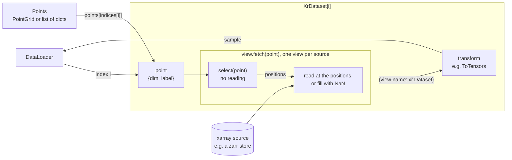
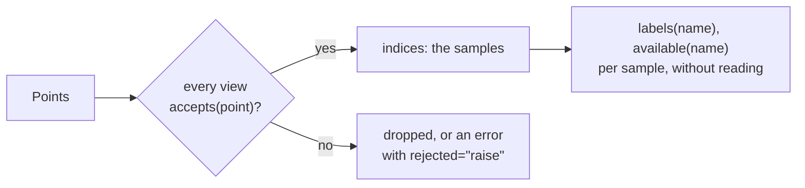

# xarray_torch_dataset

PyTorch datasets on top of xarray, built from small, swappable parts.

This is an experiment. The interfaces are still changing; `STATUS.md` records the current state, the design decisions and the open questions.

## The idea

A sample is described in three steps:



- A **point** says where a sample is, as coordinate labels: `{"time": np.datetime64("2020-01-05")}`.
- A **view** says what to read from one xarray source for a point, for example the four time steps up to the point. Each source gets its own view, so sources with different grids or resolutions can be combined.
- A **transform** turns the fetched xarray data into what the model needs, usually tensors.

Views only compute positions; they do not read. The dataset can therefore check at construction which points every view can serve, and it keeps only those.



## Example

```python
import numpy as np
import torch
import xarray as xr

from xarray_torch_dataset import OffsetView, PointGrid, ToTensors, XrDataset

times = np.arange("2020-01-01", "2020-02-01", dtype="datetime64[D]")
dims = ("time", "lat", "lon")
inputs = xr.Dataset(
    {"t2m": (dims, np.random.rand(31, 8, 8)), "u10": (dims, np.random.rand(31, 8, 8))},
    coords={"time": times},
)
targets = xr.Dataset(
    {"precip": (dims, np.random.rand(31, 8, 8))}, coords={"time": times}
)

last_four_days = np.arange(-3, 1) * np.timedelta64(1, "D")

dataset = XrDataset(
    points=PointGrid(time=times),
    views={
        # the point's day and the three days before it
        "x": OffsetView(inputs, ["t2m", "u10"], offsets={"time": last_four_days}),
        # the point's day only
        "y": OffsetView(targets, ["precip"]),
    },
    transform=ToTensors(),
)

print(len(dataset))  # 28: the first three days have no full history
batch = next(iter(torch.utils.data.DataLoader(dataset, batch_size=4)))
print({name: tensor.shape for name, tensor in batch.items()})
# {'x': torch.Size([4, 2, 4, 8, 8]), 'y': torch.Size([4, 1, 8, 8])}
```

`examples/` has two longer scripts: `history_windows.py` and `forecasts.py`.

## The parts

**Points.** Anything with `__len__` and `__getitem__(i)` that returns a point will do, including a plain list of dicts. `PointGrid(time=times, lat=lats)` gives every combination of the labels without building the list.

**Views.** A view is usually written for the application at hand (see below). Two are included, as examples and for the common cases:

| View | Selects |
|---|---|
| `OffsetView` | Fixed offsets from the point's labels, such as the last four hours. Offsets are added to the label and looked up in the source, so along time they are durations, not numbers of steps. Dimensions without offsets are selected at exactly the point's label. |
| `FindLatestForecastView` | From a forecast source with `init_time` and `lead_time`, the most recent forecast for the point's valid time. This aligns, say, a 3-hourly forecast with hourly points. |

**What a view does for a point.** The dataset calls `view.fetch(point)`, which runs as below. One question decides everything: does every position that `select` returned lie inside the source? If so, the view reads there. If not, its `unavailable` setting decides: `"reject"` raises, which the dataset avoids by dropping such points at construction, and `"fill"` reads what exists and fills the rest. A view's author writes `select`, and `labels` only to report what the view asked for where the source lacks it; the base class does the rest.


**Unavailable data.** A source may not have everything a point asks for: a history window can reach back before the source starts, or the source may lack the point's label. What happens then is decided in two places.

- Each view takes `unavailable="reject"` (the default) or `unavailable="fill"`. With `"reject"`, the view rejects such a point. With `"fill"`, it accepts every point and returns NaN for whatever the source lacks, in the shape a complete selection would have. `view.accepts(point)` gives this answer; the dataset asks it of every view for every point at construction, to decide which points to keep. Override it only for a cheaper check.
- The dataset takes `rejected="drop"` (the default) or `rejected="raise"`. With `"drop"`, points that some view rejected are left out. With `"raise"`, they are an error at construction, which helps to catch a misaligned source.

`dataset.n_rejected` says how many points each view rejected, for example `{"x": 3, "y": 0}`. A few points rejected by a history view are an edge effect; most points rejected by one view usually mean that its source is on a different grid. A point rejected by several views is counted for the first of them.

Asking every view about every point happens when the dataset is constructed and takes time on large point sets (roughly 0.1 ms per point and view). `XrDataset(..., validate=False)` skips it. Every point is then kept, and one that a view would have rejected raises an `IndexError` when it is fetched, which may be well into an epoch. It never returns wrong data. Use it when you already know that every point can be served.

A filling view never rejects a point, so the other views decide which points the dataset has. If every view fills, no point is rejected at all, and a point that no source has data for becomes a sample of NaN; keep at least one rejecting view, typically the target, to avoid that. Because integers cannot hold NaN, a filling view returns integer and boolean values as floats, for every point.

Whether a view has all data for a point, and which labels it selects, can be asked without reading anything. `view.available(point)` says whether the view has all data for the point. For a rejecting view this is the same answer as `accepts`; a filling view accepts every point, so only `available` tells whether something would be filled. `view.labels(point)` gives the coordinate labels of the selection per dimension. For the whole dataset, `dataset.available("x")` and `dataset.labels("x")` give them for every sample, as arrays with one row per sample.

All of this is only about data the source does not have: NaN values stored in a source are returned as they are, and a point that lacks a label a view needs is an error.

**Transforms.** A transform receives `{view name: xr.Dataset}` and returns the sample. The data is already in memory at that point: reading is the views' job, and a transform only reshapes what was read. Because it gets xarray objects, it can use names, dimensions and coordinates to build what the model needs.

`ToTensors` is the one included. It stacks the variables of each view into one `float32` tensor, variables first, and keeps only the values. The variables of a view must have the same dimensions; it raises otherwise instead of broadcasting them.

A `DataLoader` needs a transform that returns tensors or arrays, because torch cannot batch xarray objects. Without a transform, `dataset[i]` returns the xarray data itself, which is useful for looking at samples.

## Writing a view

Subclass `View` and implement `select`, which returns positions per dimension as `xr.Dataset.isel` accepts them. `locate` turns coordinate labels into positions.

```python
import numpy as np

from xarray_torch_dataset import View


class DayBeforeView(View):
    """The source's value one day before the point."""

    def select(self, point):
        return {"time": self.locate("time", point["time"] - np.timedelta64(1, "D"))}
```

A label that the source lacks gives the position `None` (or `-1` inside an array of positions), which marks the data as missing. The labels along a dimension that a view looks up must be unique; `locate` raises otherwise. `select` should mark missing data this way rather than raise, and it should not read any data.

A filled entry has NaN as its data and, by default, a missing label (NaT or NaN) as its coordinate. A view that knows which label it asked for although the source lacks it can say so by overriding `labels`; filling then puts that label on the coordinate. `OffsetView` does this, so a history window that reaches back before the source starts still shows the days it covers. A view that matches forecasts to points could report the run it chose and the lead time it needed in the same way, also when that run does not reach far enough.

```python
class DayBeforeView(View):
    """The source's value one day before the point, labelled by that day."""

    def labels(self, point):
        return {"time": point["time"] - np.timedelta64(1, "D")}

    def select(self, point):
        return {"time": self.locate("time", self.labels(point)["time"])}
```

## Reading from zarr

Open stores without dask:

```python
ds = xr.open_dataset("data.zarr", engine="zarr", chunks=None)
```

`xr.open_zarr` and `chunks={}` give dask-backed data, which has two drawbacks here:

- **It can hang.** If the main process reads from a dask-backed dataset (looking at `dataset[0]` is enough) and a `DataLoader` then starts workers by forking, which is the default on Linux, the first batch never arrives.
- **It was not faster.** In the benchmarks, dask was slower on small and medium chunks and about equal on large ones.

If you need dask, start the workers with `DataLoader(..., multiprocessing_context="forkserver")` or use dask's synchronous scheduler (`dask.config.set(scheduler="synchronous")`).

The benchmark results are in `STATUS.md`, and the scripts in `benchmarks/`.

## Development

```bash
git clone git@gitlab.dkrz.de:b383481/xarray_torch_dataset.git
cd xarray_torch_dataset
uv sync
uv run pre-commit install
uv run pytest
```

Pre-commit runs `ruff`, `mypy` and `pytest`. `STATUS.md` has more on the setup.
